# CNCDesign

**Entorno multi-agente de escritorio para diseño 3D/2D y automatización de pedidos `.dxf` para fabricación CNC.**

CNCDesign combina un **visor CAD 2D/3D** (Three.js + `dxf-render`) con una **terminal de IA** que crea y modifica modelos a partir de lenguaje natural, y un juego de **herramientas de edición manual** (mover, rotar, escalar, espejar) que funcionan incluso sin claves de IA ni conexión a internet.

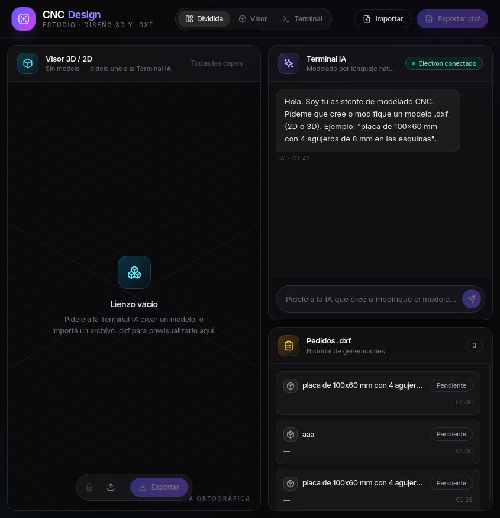

## Índice

- [Características principales](#características-principales)
- [Capturas](#capturas)
- [Arquitectura](#arquitectura)
- [Stack](#stack)
- [Estructura del proyecto](#estructura-del-proyecto)
- [Instalación](#instalación)
- [Uso](#uso)
- [Configuración de IA](#configuración-de-ia)
- [Scripts npm](#scripts-npm)
- [Verificación y capturas automatizadas](#verificación-y-capturas-automatizadas)
- [Skill de desarrollo (OpenCode)](#skill-de-desarrollo-opencode)
- [Notas técnicas](#notas-técnicas)
- [Licencia](#licencia)

## Características principales

- **Visor 3D/2D** — renderiza cualquier `.dxf` (importado o generado por IA) con Three.js y `dxf-render`. Cámara orbitable, vistas rápidas (frontal/superior/lateral/isométrica), cuadrícula, encuadre automático, selección de capas, pantalla completa y tarjeta de atajos integrada.
- **Terminal IA** — chat en español con historial; el usuario describe el modelo y el router multi-IA elige el proveedor adecuado. La respuesta incluye un bloque `dxf` que puede **aplicarse al visor** o **exportarse** como archivo.
- **Router multi-IA con fallback** — Anthropic (Claude), OpenAI (GPT) y Ollama (local, gratuito). Clasifica la tarea (crear / editar / imagen / corregir) y cae en cascada al siguiente proveedor disponible si el principal falla.
- **Selector de modelo** — píldora sobre el compositor de la terminal con lista de proveedores y **listado en vivo de los modelos Ollama instalados** (`/api/tags`). La elección se guarda entre sesiones.
- **Configuración de claves API** — modal con campos mostrar/ocultar; se guardan localmente en `config-ia.json` (dentro de los datos de usuario de la app) y tienen prioridad sobre las variables de entorno.
- **Edición manual sin IA** — mover, rotar, escalar y espejar las entidades del modelo actual con campos numéricos y presets; incluye **pila de deshacer** de 15 pasos. Todo el ciclo (texto `.dxf` → entidades → transformación → texto `.dxf`) ocurre en módulos puros y testables.
- **Pedidos** — cada petición a la IA queda registrada con estado (pendiente / procesando / completado / rechazado), modelo usado y hora.
- **Importar / Exportar `.dxf`** — diálogos nativos de Electron; la exportación escribe el texto DXF vigente del modelo.

## Capturas

| | |
|---|---|
|  **Vista general** — arranque en vista dividida: visor + terminal IA + pedidos. | 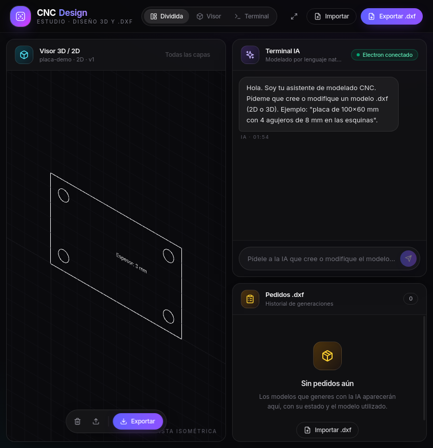 **Vista dividida** — placa `.dxf` cargada en el visor. |
| 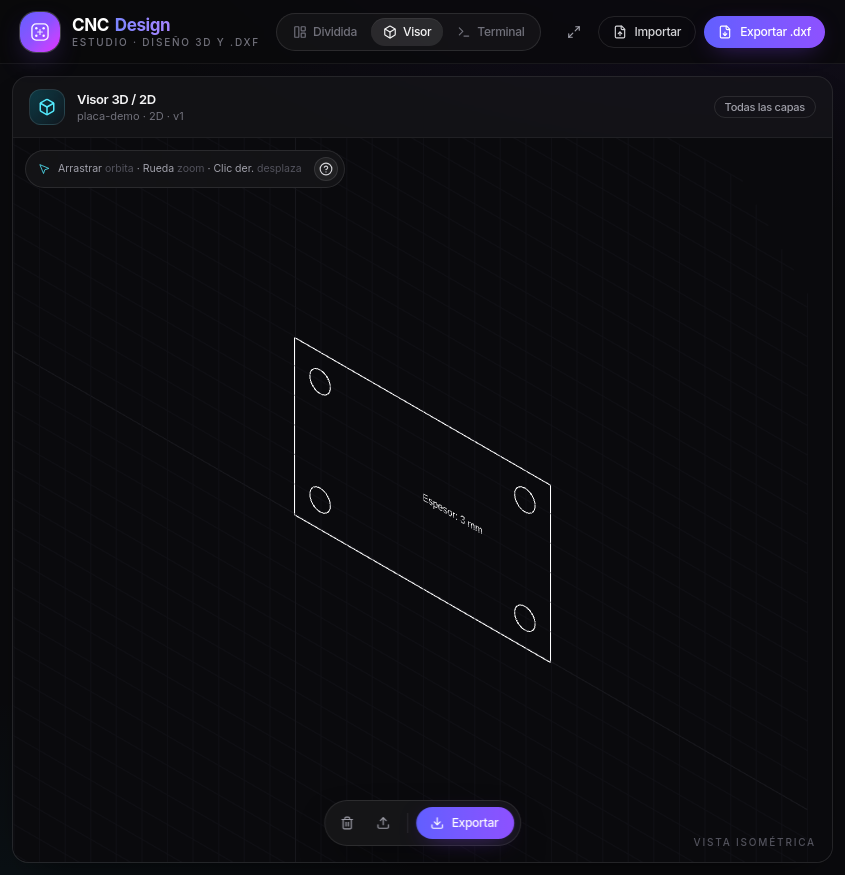 **Modo visor** — vista completa con barra de pistas y nombre de vista actual. | 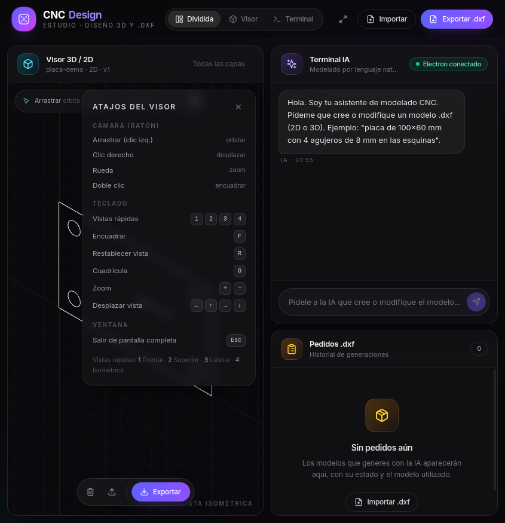 **Atajos del visor** — tarjeta de ayuda con ratón, teclado y pantalla completa. |
| 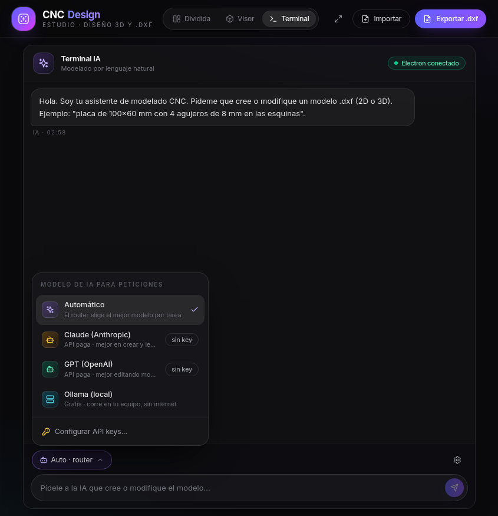 **Selector de modelo IA** — elección de proveedor sobre el compositor. | 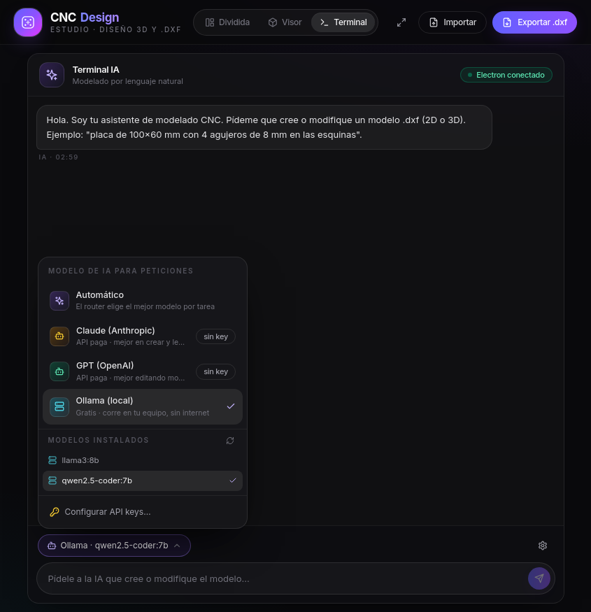 **Modelos Ollama** — lista en vivo de modelos instalados localmente. |
| 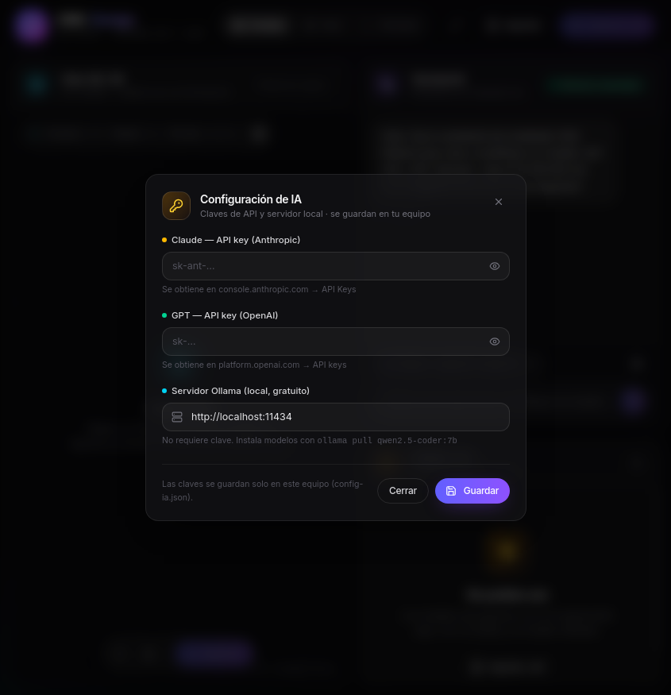 **Configuración IA** — claves de Anthropic/OpenAI y URL de Ollama. | 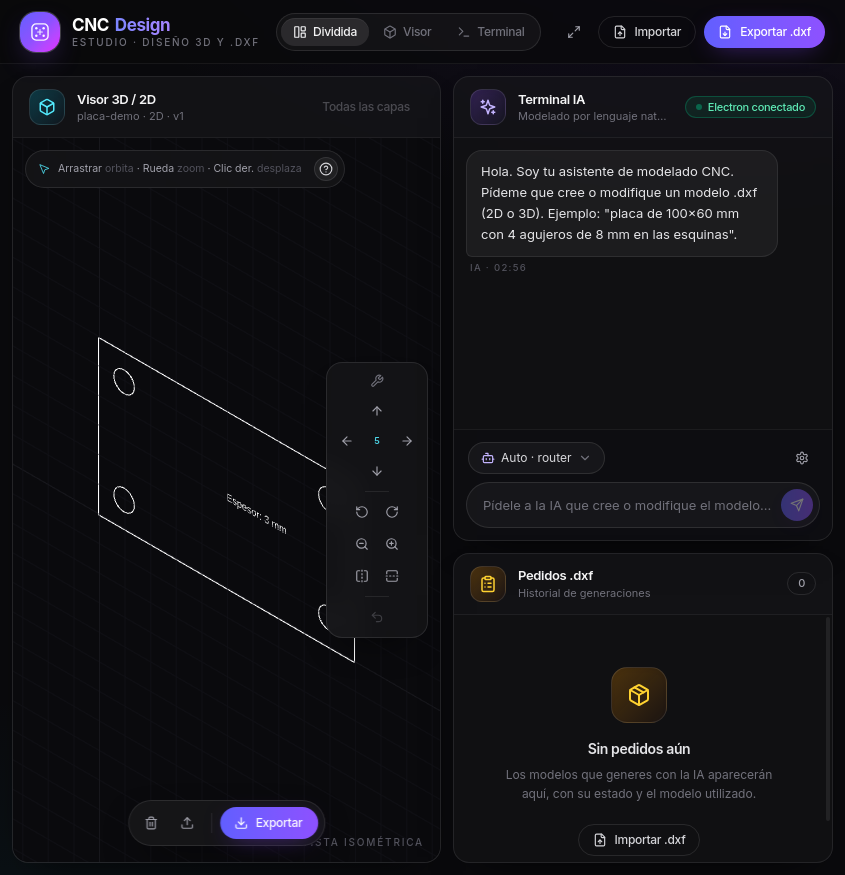 **Herramientas de edición** — mover, rotar, escalar, espejar y deshacer. |
| 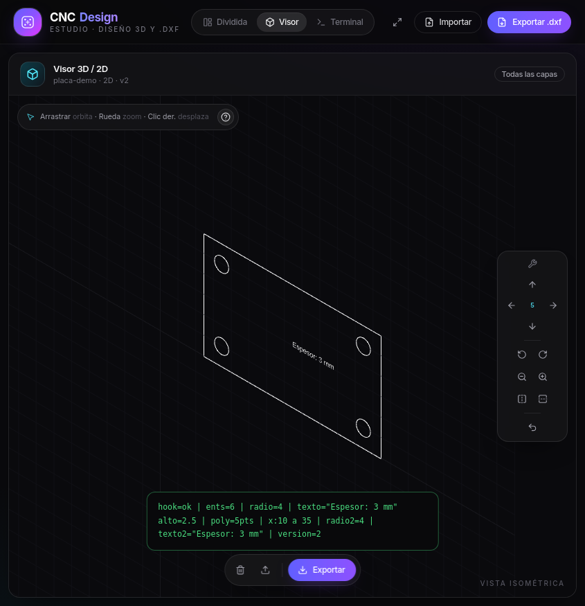 **Edición aplicada** — el modelo se regeneró a partir de la transformación. | 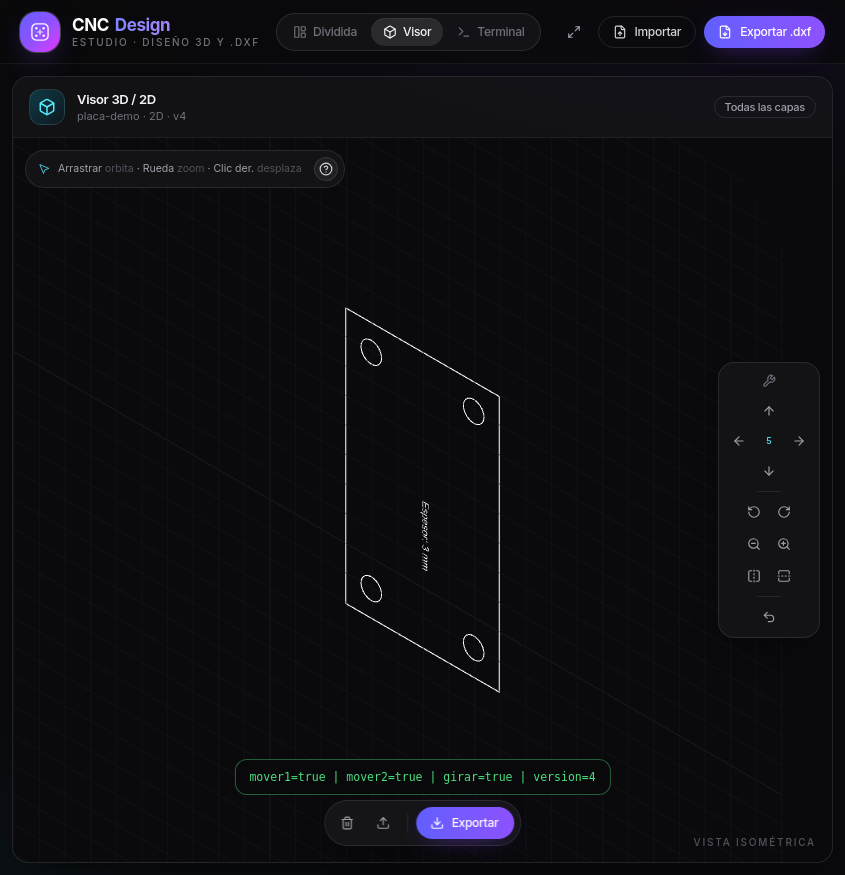 **Rotación 90°** — resultado de aplicar un preset de rotación. |
| 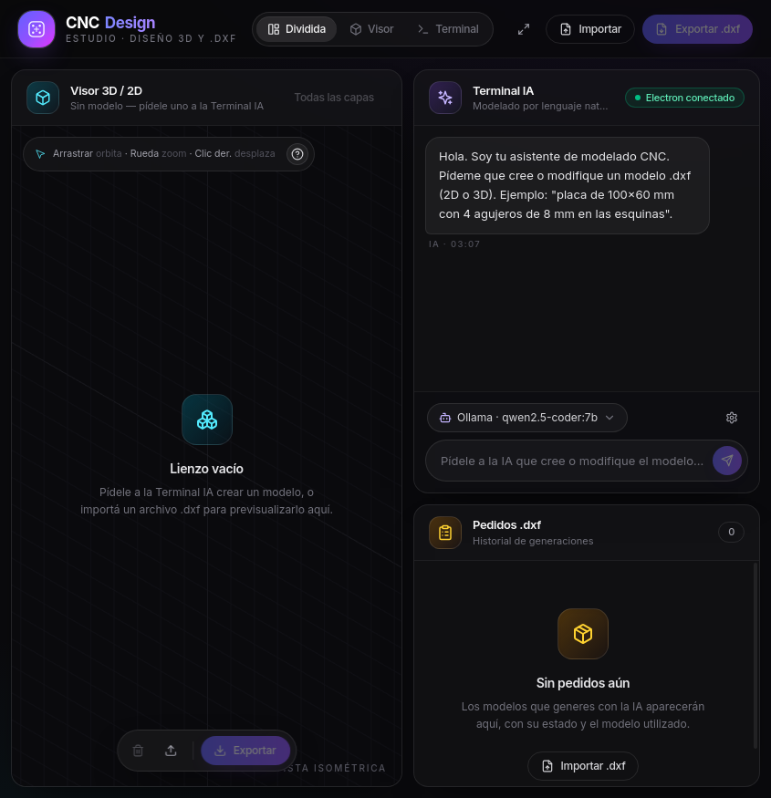 **Persistencia** — la selección de modelo (Ollama · qwen2.5-coder:7b) sobrevive al reinicio. | |

> Todas las capturas se generaron con el flujo automatizado `CAPTURA_UI` descrito en [Verificación y capturas](#verificación-y-capturas-automatizadas).

## Arquitectura

```
┌───────────────────────────── Ventana Electron ───────────────────────────────┐
│  RENDERER (React + Zustand + Tailwind v4)                                    │
│                                                                              │
│  ┌──────────────┐   ┌───────────────────────────┐   ┌──────────────────────┐ │
│  │  Visor 3D/2D │   │        Terminal IA        │   │    Pedidos .dxf      │ │
│  │  (Three.js + │   │  prompt + selector de IA  │   │  estado + modelo IA  │ │
│  │  dxf-render) │   │  ┌─────────────────────┐  │   │  usado + hora        │ │
│  └──────▲───────┘   │  │ Selección modelo IA │  │   └──────────────────────┘ │
│         │           │  └─────────────────────┘  │                            │
│         │ dxfTexto  └─────────────┬─────────────┘                            │
│         │                         │ pedir()                                  │
│         │                         ▼                                          │
│  ┌──────┴──────────────────────────────────────────────────────────────────┐ │
│  │ Router multi-IA (src/ai/router.ts)                                      │ │
│  │  clasifica tarea → elige proveedor → ejecuta con fallback → extrae      │ │
│  │  el bloque ```dxf``` de la respuesta                                    │ │
│  └──────┬──────────────────┬──────────────────┬────────────────────────────┘ │
│         ▼                  ▼                  ▼                              │
│   Anthropic (Claude)   OpenAI (GPT)      Ollama (local · gratis)             │
│                                                                              │
│  Herramientas de edición: texto DXF → entidades → transformar → DXF          │
└──────────────────────────────────┬───────────────────────────────────────────┘
                                   │ IPC (contextBridge)
┌──────────────────────────────────┴───────────────────────────────────────────┐
│  MAIN PROCESS (electron/main.ts, CommonJS)                                   │
│  · Ventana y pantalla completa        · Diálogos importar/exportar .dxf      │
│  · config-ia.json (claves API)        · Listado de modelos Ollama            │
│  · Utilidad de captura UI (CAPTURA_UI) · Hooks de desarrollo                 │
└──────────────────────────────────────────────────────────────────────────────┘
```

### Flujo de una petición

1. El usuario escribe en la **Terminal IA** (ej: *"placa de 100×60 mm con 4 agujeros de 8 mm"*).
2. El router **clasifica la tarea** (`crear` / `editar` / `imagen` / `corregir`) por palabras clave y otros indicios, salvo que el usuario haya fijado un proveedor en el selector (que entonces se intenta primero).
3. Se ejecuta la petición contra el proveedor elegido; si falla (sin clave, error de red, timeout), se **cae en cascada** al siguiente proveedor disponible (terminando en Ollama local si está activo).
4. De la respuesta se extrae el **bloque `dxf`**; opcionalmente se **valida** con las reglas CNC (`src/cad/validator.ts`).
5. El usuario pulsa **Aplicar al visor**: el texto DXF pasa al renderer, que lo parsea (`dxf-render`) y lo dibuja. Desde allí puede **editarse a mano** o **exportarse**.

### Módulos

| Módulo | Ruta | Responsabilidad |
|---|---|---|
| Router IA | `src/ai/router.ts` | Clasificación de tarea, preferencia de proveedor, fallback, extracción del DXF |
| Proveedores | `src/ai/providers/` | `anthropic.ts`, `openai.ts`, `ollama.ts` + interfaz común en `base.ts` |
| Prompts de modelado | `src/ai/prompts/` | System prompts de referencia (creación, edición, corrección, image-to-CAD) |
| Núcleo CAD | `src/cad/` | `parser.ts` (DXF→entidades), `writer.ts` (entidades→DXF R2010), `generator.ts` (primitivas), `validator.ts` (reglas CNC) |
| Edición | `src/cad/transformaciones.ts`, `src/cad/edicion.ts` | Transformaciones puras y ciclo completo texto→entidades→texto |
| UI | `src/renderer/components/` | `App`, `Viewer3D`, `TerminalIA`, `SelectorModeloIA`, `ModalConfigIA`, `HerramientasEdicion`, `Toolbar`, `OrderPanel`, sistema de diseño en `ui.tsx` |
| Estado | `src/renderer/store/modelStore.ts` | Zustand: modelo actual, pedidos, preferencia de IA, pila de deshacer, modal de config |
| Electron | `electron/main.ts`, `electron/preload.ts` | Ventana, IPC, diálogos, `config-ia.json`, capturas; puente `window.apiCAD` |
| Contrato IPC | `electron/ipc/canales.ts` | Documento tipado de todos los canales que cruzan el puente |

## Stack

- **Desktop:** Electron + TypeScript (main compilado a CommonJS)
- **UI:** React 18 + Tailwind CSS v4 (CSS-first, sin `tailwind.config`) + `class-variance-authority`
- **Visor:** Three.js (`OrbitControls`) + `dxf-render` (parser y creador de objetos Three)
- **Estado:** Zustand (con `persist` en `localStorage` para lo esencial)
- **IA:** Router propio; SDKs `@anthropic-ai/sdk` y `openai`; Ollama vía HTTP (`/api/chat`, `/api/tags`)
- **Empaquetado:** `electron-builder` (AppImage en Linux, NSIS en Windows, app en macOS)

## Estructura del proyecto

```
CNCDesign/
├── electron/                    # Proceso principal (Node)
│   ├── main.ts                  # Ventana, IPC, config IA, capturas automatizadas
│   ├── preload.ts               # Puente seguro → window.apiCAD
│   └── ipc/canales.ts           # Contrato tipado de los canales IPC (documentación viva)
├── src/
│   ├── ai/                      # Router multi-IA y proveedores
│   ├── cad/                     # Núcleo CAD puro (sin dependencias de UI/Electron)
│   ├── renderer/                # UI React
│   │   ├── components/          # App, Viewer3D, TerminalIA, paneles, sistema de diseño
│   │   └── store/modelStore.ts  # Estado global (Zustand)
│   ├── index.css                # Tema oscuro (Tailwind v4 CSS-first)
│   └── types.d.ts               # Tipos para dxf-render
├── docs/capturas/               # Capturas de referencia (flujo CAPTURA_UI)
├── scripts/instalar-skill.sh    # Instalador de la skill dev en otro entorno
├── .opencode/skills/cnc-design-dev/   # Skill de desarrollo OpenCode (ver sección)
├── index.html                   # Punto de entrada del renderer (Vite)
├── vite.config.mts              # Vite: puerto 5123, alias, stub FXAAPass
├── tsconfig.json                # Chequeo de tipos (no emite)
├── tsconfig.build.json          # Compilación a CJS de src + electron → dist/
├── electron-builder.json        # Configuración de empaquetado
└── INICIO_RAPIDO.md             # Guía de 5 minutos para desarrollo
```

## Instalación

### Requisitos

- **Node.js 22** y npm (probado con Node v22.22.1)
- Linux con entorno gráfico (o `xvfb-run` para servidores headless)
- *(Opcional)* **[Ollama](https://ollama.com)** para IA local gratuita:
  ```bash
  ollama pull qwen2.5-coder:7b   # o cualquier modelo de código
  ```
- *(Opcional)* Claves de **Anthropic** y/o **OpenAI** para IA en la nube

### Pasos

```bash
# 1. Dependencias
npm install

# 2. Variables de entorno (opcional; también se pueden guardar desde la UI)
cp .env.example .env
#    Edita .env con tus claves (ANTHROPIC_API_KEY, OPENAI_API_KEY, OLLAMA_URL…)

# 3. Desarrollo (compila Electron y levanta Vite + la app)
npm run dev

# 4. Build de producción + AppImage
npm run build     # → release/
```

> **Nota headless:** en servidores sin pantalla, Electron necesita `--no-sandbox --disable-gpu` y un display virtual (`xvfb-run`). Los scripts `dev`/`start` ya incluyen los flags de Chromium.

## Uso

### Flujo típico

1. Abre la app (`npm run dev`).
2. En la **Terminal IA** escribe lo que necesitas, por ejemplo:
   *"placa de 100×60 mm con 4 agujeros de 8 mm en las esquinas"*.
3. El router elige el modelo (o usa el que fijes en el **selector**). Al terminar verás el chat con el bloque DXF y los botones **Aplicar al visor** / **Exportar .dxf**.
4. Revisa el modelo en el **Visor**. Si necesitas retoques, usa las **herramientas de edición** del visor (no hace falta IA):
   - **Mover** en X/Y · **Rotar** (ángulo o presets 90°) · **Escalar** (factor) · **Espejar** (H/V) · **Deshacer** (15 pasos).
5. **Exportar .dxf** para obtener el archivo listo para el CAM.

### Atajos del visor

| Acción | Entrada |
|---|---|
| Orbitar | Arrastrar con clic izquierdo |
| Desplazar | Clic derecho (arrastrar) |
| Zoom | Rueda del ratón (o `+` / `−`) |
| Encuadrar modelo | Doble clic o tecla `F` |
| Vistas rápidas | `1` Frontal · `2` Superior · `3` Lateral · `4` Isométrica |
| Restablecer vista | `R` |
| Mostrar/ocultar cuadrícula | `G` |
| Desplazar vista (paso fino) | Flechas `←↑→↓` |
| Salir de pantalla completa | `Esc` |
| Ayuda de atajos | Botón `?` en el visor |

## Configuración de IA

### Precedencia

1. **Modal de configuración** (icono ⚙ en la Terminal IA) → se guarda en `config-ia.json` dentro de `app.getPath('userData')`.
2. **Variables de entorno** (`.env` o el entorno del sistema) — se usan cuando la app arranca si no hay valor guardado.

Al guardar desde el modal, los proveedores se recargan en caliente (`recargarProveedores()`), sin reiniciar la app.

### Variables de entorno

| Variable | Efecto | Valor por defecto |
|---|---|---|
| `ANTHROPIC_API_KEY` | Clave de Anthropic (Claude) | *(vacío → proveedor no disponible)* |
| `OPENAI_API_KEY` | Clave de OpenAI (GPT) | *(vacío → proveedor no disponible)* |
| `OLLAMA_URL` | URL del servidor Ollama | `http://localhost:11434` |
| `OLLAMA_MODEL` | Modelo Ollama por defecto | `qwen2.5-coder:7b` |
| `NODE_ENV` | `development` activa DevTools y los hooks de desarrollo | — |

### Enrutamiento por tarea

Con el selector en **Auto**, el router clasifica la intención y aplica esta preferencia (con fallback en cascada; Ollama actúa como último recurso gratuito):

| Tarea detectada | Preferido | Fallbacks |
|---|---|---|
| Crear un modelo nuevo | Anthropic (Claude) | OpenAI → Ollama |
| Editar un modelo existente | OpenAI (GPT) | Anthropic → Ollama |
| Desde imagen / dibujo | Anthropic (Claude) | OpenAI → Ollama |
| Corregir errores | OpenAI (GPT) | Anthropic → Ollama |

Con un proveedor fijado en el selector, ese se intenta **primero** y después se aplica la misma cascada. Referencia de benchmarks usada para el diseño del router (Parametric CAD Bench v3, sept. 2026):

| Tarea | Mejor modelo | Puntuación |
|---|---|---|
| Creación general | Claude Opus 5.5 | 61.03 |
| Create (texto → CAD) | Claude Fable 5.1 | 55.48 |
| Create-and-Edit | GPT-6 Astra | 44.37 |
| Image-to-CAD | Claude Opus 5.5 | 84.66 |

## Scripts npm

| Script | Descripción |
|---|---|
| `npm run dev` | `predev` compila Electron (tsc) y luego Vite (puerto 5123) + Electron con recarga del renderer |
| `npm run build` | `vite build` → `tsc -p tsconfig.build.json` → `electron-builder` (genera `release/`) |
| `npm run start` | Lanza la app ya compilada (`electron dist/electron/main.js`) |
| `npm run typecheck` | `tsc --noEmit` sobre toda la base |
| `npm run lint` | ESLint sobre `src/` |
| `npm run preview` | Sirve el bundle del renderer para revisión rápida en navegador |
| `npm run electron` | Abre Electron usando `main` de `package.json` |

## Verificación y capturas automatizadas

El proceso principal incluye una utilidad de captura pensada para entornos **headless** (CI o agentes de desarrollo). Se activa con variables de entorno y la app se cierra sola al terminar:

```bash
# Captura simple de la UI
CAPTURA_UI=/tmp/ui.png npm run dev

# Cargar un .dxf antes de capturar
CAPTURA_UI=/tmp/ui.png CAPTURA_UI_DXF=demo.dxf npm run dev

# Forzar modo de vista: dividida | fullVisor | fullTerminal
CAPTURA_UI=/tmp/ui.png CAPTURA_UI_VISTA=fullVisor npm run dev

# Ejecutar JavaScript arbitrario antes de la captura (dev)
CAPTURA_UI=/tmp/ui.png CAPTURA_UI_JS="window.__CNC.transformaciones.rotar(90)" npm run dev
```

En modo desarrollo se expone además el hook `window.__CNC` (`{ edicion, transformaciones, store }`) para inspeccionar o manipular el estado desde la consola o desde `CAPTURA_UI_JS`. Todas las capturas de este README se generaron con este flujo.

## Skill de desarrollo (OpenCode)

El repositorio incluye una **skill de OpenCode** lista para llevar a otro entorno de ejecución:

```
.opencode/skills/cnc-design-dev/
├── SKILL.md                     # Cuándo usarla y flujo de trabajo
├── references/
│   ├── arquitectura.md          # Mapa de módulos y convenciones del código
│   ├── entorno-desarrollo.md    # Requisitos, instalación y comandos
│   ├── verificacion.md          # typecheck/build + flujo CAPTURA_UI + hook __CNC
│   ├── configuracion-ia.md      # Claves, precedencia y enrutamiento
│   └── agentes-desarrollo.md    # Lineup de agentes de desarrollo (6 roles)
└── scripts/
    └── verificar.sh             # typecheck + build de verificación
```

**Cómo usarla en otro entorno:**

- **Dentro de este repositorio:** OpenCode la descubre automáticamente al trabajar en el proyecto (fuente de proyecto `.opencode/skills`).
- **En el resto de tus proyectos** (skill global del usuario):
  ```bash
  bash scripts/instalar-skill.sh
  # copia la skill a ~/.config/opencode/skills/cnc-design-dev/
  ```
- **Manualmente:** copia la carpeta `.opencode/skills/cnc-design-dev/` a `${XDG_CONFIG_HOME:-$HOME/.config}/opencode/skills/`.

Una vez instalada, pídesela por su id (`cnc-design-dev`) o menciónala como `@cnc-design-dev`.

## Notas técnicas

- **Tailwind v4 CSS-first** — no hay `tailwind.config.js`; el tema se define con `@theme` en `src/index.css`. El tema es oscuro fijo (`color-scheme: dark`).
- **Compilación CJS** — `tsconfig.build.json` emite CommonJS a `dist/` (junto al bundle de Vite). Por eso `import.meta` no está disponible en el código compartido; los hooks de desarrollo usan `process.env.NODE_ENV`.
- **`dxf-render/parser` es solo ESM** — importarlo con `require` lanza `ERR_PACKAGE_PATH_NOT_EXPORTED`. Por eso el parser se usa únicamente desde el renderer (Vite); los módulos de `src/cad/` que deben funcionar en Node puro no lo importan.
- **Stub de FXAAPass** — `dxf-render` importa `three/addons/postprocessing/FXAAPass.js`, que puede no existir en la versión instalada de Three. Vite lo redirige a un stub local (`src/renderer/components/stubs/FXAAPass.stub.js`) y marca `three/addons/*` como externo.
- **Ollama** — la generación corre con los parámetros dentro de `options` (`temperature`, `num_predict`), `keep_alive: '5m'` y un timeout de 15 minutos (en CPU, un modelo 7B en frío puede tardar ~5 minutos).
- **Persistencia Zustand** — se persisten `pedidos`, `historial`, `proveedorIA` y `ollamaModelo`. El modelo actual **no** se persiste a propósito; la pila de deshacer vive solo en memoria.
- **Empaquetado** — `electron-builder.json` espera iconos en `assets/` (`icon.png` para Linux, `icon.ico` para Windows); añádelos antes de publicar un instalador.

## Licencia

MIT
